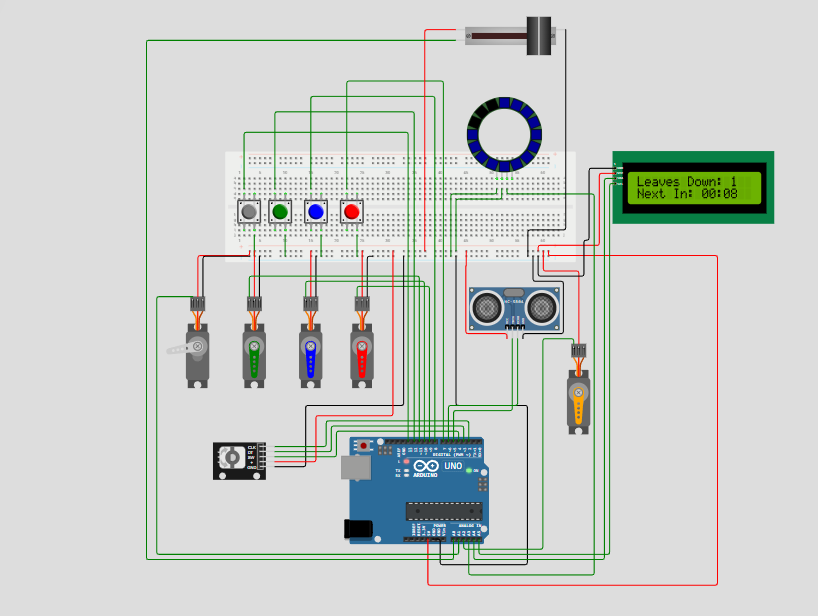

# Yonko
DH2400 HT26 Physical Interaction Design and Realization - KTH Royal Institute of Technology

# Interactive Plant Simulator

An Arduino-based interactive hardware system that simulates plant behaviors based on human interaction. The system is modular, divided into five main components: Mushroom, Flower, Leaves, and Pond.

## Hardware Requirements

- 1x Arduino UNO (or compatible board)
- 5x Micro Servos (SG90 or similar)
- 1x HC-SR04 Ultrasonic Sensor
- 1x KY-040 Rotary Encoder
- 1x FSR for weight detection
- 1x WS2812 NeoPixel Ring (16 LEDs)
- 1x I2C 1602 LCD Display (Just for better visual clue about timer)
- 4x Buttons (Will be on the leaves)
- External 5V Power Supply (Required for servos)

## Pin Wiring Guide

### Power Supply (CRITICAL)
Do not power the 5 servos directly from the Arduino's 5V pin. 
- Connect all Servo VCC (Red) wires to an External 5V Power Supply.
- Connect the External Power Supply GND to the Arduino GND (Common Ground).
- The sensors, LCD, and rotary encoder can be powered via the Arduino 5V pin.

### Arduino UNO Pin Mapping

**Analog Pins:**
- A0 : Pond - FSR (Signal)
- A1 : Leaves - Servo 4 (Signal)
- A2 : Flower - Servo (Signal)
- A3 : Pond - WS2812 NeoPixel (DIN)
- A4 : LCD - SDA
- A5 : LCD - SCL

**Digital Pins:**
- D2 : Mushroom - Rotary Encoder (CLK)
- D3 : Mushroom - Rotary Encoder (DT)
- D4 : Mushroom - Rotary Encoder (SW / Button)
- D5 : Flower - HC-SR04 Ultrasonic (Trig)
- D6 : Flower - HC-SR04 Ultrasonic (Echo)
- D7 : Leaves - Button 1 (Other leg to GND)
- D8 : Leaves - Button 2 (Other leg to GND)
- D9 : Leaves - Servo 1 (Signal)
- D10 : Leaves - Servo 2 (Signal)
- D11 : Leaves - Servo 3 (Signal)
- D12 : Leaves - Button 3 (Other leg to GND)
- D13 : Leaves - Button 4 (Other leg to GND)

## Module Behaviors

### 1. Pond (Water Level & Hydration)
- Uses a FSR to simulate a coaster detecting a cup's weight.
- A WS2812 NeoPixel ring displays the current water level.
- Water level naturally decreases over time (evaporation).
- **Interaction:** Lift the cup (slide to 0%), then place it back with a lower weight (slide to 70%-80%). The system calculates the weight difference and refills the pond (increases blue LEDs) if a drinking action is detected.

### 2. Flower (Proximity Reaction)
- Uses an HC-SR04 ultrasonic sensor to detect user presence and approach speed.
- **Interaction:** The flower (servo) closes under two conditions:
  1. A fast approach is detected by the ultrasonic sensor.
  2. An object is close AND the Leaf timer is currently active.
- Automatically re-opens after 3 seconds of no trigger.

### 3. Leaves (Timer & Queue System)
- Controls 4 servos via 4 buttons on each leaves.
- **Interaction:** Pressing a leaf drops the leaf. 
- The system registers the presses in a First-In-First-Out queue. It runs a countdown timer (15 minutes) and sequentially raises the leaves back up according to the order they were pressed.

### 4. Mushroom (Audio Control Simulation)
- Uses a KY-040 rotary encoder.
- **Interaction:** 
  - Rotate: Adjusts the music volume up or down.
  - Press: Toggles the Play/Pause state.

### 5. LCD (System Monitor - Just for testing)
- Uses an I2C 1602 LCD.
- Displays the number of leaves currently down (active timer count).
- Displays a real-time MM:SS countdown timer for the next leaf to rise.

  
  <em>Simulator Overview</em>

## Installation & Setup

1. Assemble the circuit according to the Pin Wiring Guide. Ensure the common ground is established between the external power supply and the Arduino.
2. Install the following libraries via the Arduino Library Manager:
   - `Servo` (by Michael Margolis)
   - `Adafruit NeoPixel`
   - `LiquidCrystal I2C` (by Frank de Brabander)
3. Compile and upload `sketch.ino` to the Arduino.
4. Open the Serial Monitor (9600 baud rate) to view real-time state changes and debug information.